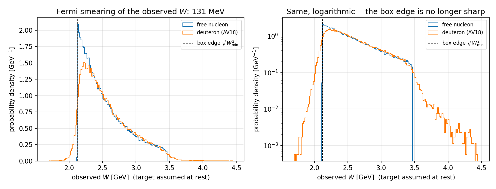

# Fermi motion for a deuteron target — what was decided and why

Branch `fermi`, forked from `production` at `16412f8`.
Companion to `FERMI_BRIEF.md`, which set the task. This records the decisions
§10 asks for: the off-shell treatment, the wave function and its
normalisation, the flux convention, and the measured cost.

---

## 1. The prescription

The deuteron has exactly two constituents and nothing else, so drawing the
spectator momentum fixes everything:

```
spectator   on shell    E_s = sqrt(m_spec^2 + p_s^2),  p_s ~ n(k), isotropic
struck      off shell   E*  = M_d - E_s,               p*  = -p_s
struck + spectator = (M_d, 0, 0, 0)                    exactly
```

The struck nucleon **must** be off shell. The deuteron has no third body to
carry the binding away, so forcing both nucleons on shell invents the binding
energy plus the recoil kinetic energy — about +9 MeV for D2. (That is what the
RG-C java does, `ThreeParticles.java:250-253`,
`lv_target.setPxPyPzM(px, py, pz, m_proton)`; on an exclusive `ep -> e'pi+ n`
test it moves the missing-neutron peak by 0.055 GeV^2 and widens it by 32%
relative to the spectator prescription.)

Which nucleon is struck is not a card setting: the model's topology already
declares it, `p` for `pi0`/`eta` and `n` for `pi0n`/`etan`, and the spectator
is the other one. All four combinations follow automatically.

## 2. Off-shellness: m* in the frame, M_N in the cross section

**This was not a free choice.** `frames.assemble_event` builds every event in a
frame with the target at rest with mass `M` and closes four-momentum on the
recoil. A Lorentz map from that frame onto a laboratory nucleon of invariant
mass `m*` exists **only if `M = m*`**. Keeping `M = M_N` while placing an
off-shell nucleon in the lab breaks
`beam + d = e' + meson + N' + N_s` by about 20 MeV, and acceptance criterion 3
requires machine precision. So `m*` enters the kinematics by necessity.

The cross section is a separate question, and there VPK's decision of
2026-09-25 applies: **`M = M_N`**, standard PWIA with on-shell extrapolation,
which is the only thing the amp2609 models know. Concretely:

| what | mass | where |
|---|---|---|
| frame construction, assembly, `v_max`, electron acceptance | `m*` | `_kin`, `_vmax`, `_pass_electron_acc` |
| Born cross section | `M_N` | `_kin_xsec` -> `born_xsec` |
| radiative corrections | `M_N` | the four `rc_factor(M=self._mT, ...)` sites, untouched |

The split is why `_mT` became two attributes, `_mT` (static, on shell) and
`_mT_kin` (per event). §6 of the brief predicted this would be the most likely
source of silent errors, and it was: the first version pointed `_kin` at `m*`
and `born_H` passes `kin.M` straight into the Hand flux factor
`kappa = 8 (W2 - M^2)^2 / alpha`, so the cross section quietly followed the
off-shell mass — 0.3% at the median Fermi momentum, 2.4% at `p_s = 300 MeV/c`.
`_kin_xsec()` exists to keep that from happening again.

### The beam energy in the radiative corrections

`rc_factor` is written for *an electron of energy `Ebeam` hitting a nucleon of
mass `M` at rest*. With a moving off-shell nucleon no stand-in matches
everything, so this is a prescription, not a bug to be fixed. The three
self-consistent options and what each gets right:

| | matches | misses |
|---|---|---|
| 1. `M = M_N`, `Ebeam = E_work` | the electron's real energy in the working frame | `s`, `nu` off by `(M_N - m*)` |
| 2. `M = M_N`, `Ebeam = E_equiv` | `s` exactly | the electron has that energy in no frame |
| 3. `M = m*`, `Ebeam = E_work` | `s`, `nu`, `y` | RC formulas fed an off-shell mass |

Measured on `pi0.amp2609` at `Q2 = 2`, `W2 = 4.8`, `t = -0.30`, `phi = 1.0`,
`vcut = 0.20`:

| `p_s` [MeV/c] | `eta` (opt 1) | opt 2 | opt 3 | 2 vs 1 | 3 vs 1 |
|---|---|---|---|---|---|
| 24 | 0.89642 | 0.89679 | 0.89689 | +0.04% | +0.05% |
| 80 | 0.90079 | 0.90176 | 0.90200 | +0.11% | +0.13% |
| 170 | 0.89166 | 0.89478 | 0.89554 | +0.35% | +0.44% |
| 257 | 0.90243 | 0.91006 | 0.91164 | +0.85% | +1.02% |
| 328 | 0.90236 | 0.91535 | 0.91780 | +1.44% | +1.71% |

Below 150 MeV/c — 86% of the distribution — the three agree to 0.2%. **Option 1
is used**, on VPK's decision: it is what §6 says, and it leaves the four
`rc_factor` call sites untouched.

## 3. The wave function and its normalisation

Argonne v18 deuteron momentum distribution, `rho(k)/(2 pi)^3` from
R. B. Wiringa's tables, https://www.phy.anl.gov/theory/research/momenta/
(`h2.momentum`). Cite Wiringa *et al.*, Phys. Rev. C **89**, 024305 (2014).
Vendored as `exclurad_py/data/nk_d2_av18.dat`; the raw download and the
provenance are in `~/fermi-motion`.

**One wave function only** (VPK, 2026-09-25) — no Hulthén, Paris or CD-Bonn
option in the card, so a sample cannot be ambiguous about what made it.

**Normalised per nucleon**, `Int 4 pi k^2 n(k) dk = 1`. This is what makes
`sigma_nb` a **per-nucleon** cross section (VPK, 2026-09-25: "Let us count xs
per nucleon"), and it is consistent: the generator produces one struck nucleon
per event and weights it by the free-nucleon cross section at the event's
invariants, so the sample is a per-nucleon cross section smeared by the
momentum distribution of one nucleon inside the deuteron.

The same table serves both the struck-proton and the struck-neutron sample:
the deuteron is `T = 0`, so the proton and neutron distributions are identical
— which is why the ANL page gives only one set for it.

Verification: `validation/fermi_module.py` samples 4e5 momenta and compares
against the table cell by cell — `chi2/ndf = 1.044` over 36 cells,
`<|p_F|> = 92.6 MeV/c`, `rms 125.8 MeV/c`.

## 4. Where the k range stops, and why it is not the obvious place

`m*^2 = (M_d - E_s)^2 - p_s^2` crosses zero at `p_s = 0.7025 GeV/c`
(`k = 3.5601 fm^-1`), where the struck nucleon becomes lightlike. That is a
hard boundary — the prescription has no meaning beyond it — and it is where
the sampler's table is cut.

It is **not** a usable working limit. `gamma = E*/m*`, so as `m* -> 0` the
"rest frame" of the struck nucleon needs an unbounded boost: `E_work` reaches
1151 GeV at the ceiling. And a nucleon running away from the beam gives a
near-co-moving collision — at `p_s = 0.70` in that orientation `sqrt(s)` falls
to 0.30 GeV, below the 1.075 GeV needed to make `N + pi0` at all.

| `p_s` <= | events | `m*` [GeV] | `sqrt(s)` [GeV] | `E_work` [GeV] |
|---|---|---|---|---|
| 0.30 | 96.9% | 0.837–0.936 | 3.65–5.09 | 7.5–15.0 |
| 0.50 | 99.1% | 0.639–0.936 | 2.67–5.28 | 5.3–21.1 |
| 0.70 | 100% | 0.015–0.936 | 0.66–5.43 | 2.2–660 |

Two guards therefore reject the trial — following `_draw_mass`, **never
re-drawing**, because a re-draw would truncate `n(k)` silently and the sample
would stop following the wave function:

* `s <= W2_min`: no proposal from the majorant could be satisfied.
* `m* < 0.30 GeV` (`fermi_m_star_min`): costs 0.14% of the distribution and
  caps `E_work` near 45 GeV.

A third rejection, `_pass_fermi_frame`, is not about the tail at all: the
majorant box is fixed while the frame is not, so a `(Q2, W2, t)` that is
physical against a nucleon at rest can be past the kinematic limit against a
nucleon moving away from the beam. It is rejected beside the other cuts and
*before* the Born evaluation, so the trial counts in the denominator of
`sigma_total` with zero weight, exactly as an out-of-`t`-limits mass does.

## 5. The flux convention

**Nothing new was introduced and nothing was re-derived**, which is what §6
asked to be confirmed rather than assumed.

The event is generated in the struck nucleon's rest frame. That is the frame
the existing convention is written for — `core/hadronic.py`: the core
normalises with an effective covariant `K = |q|` photon flux (the `diffrad_vm`
convention the VM channels were validated against), and Hand-defined structure
functions from the CLAS pi0/eta fits are converted at the model boundary in
`models.base.ProtonDetectedModel._sfs`. Everything the model is asked for —
`Q2`, `W2`, `t`, `phi` — is an invariant of the `gamma* N` system and has the
same value in any frame.

The one place a mass enters the flux is `kappa = 8 (W2 - M^2)^2 / alpha`, part
of the *definition* of the structure functions, which were fitted at `M_N`.
That is `_kin_xsec`, i.e. `M_N`. See §2.

## 6. What it does to the sample, and what it costs

### The observed W (acceptance criterion 5)

100k free-nucleon against 100k deuteron, `pi0.amp2609`, Born, box
`W2 = 4.5..12`, `Q2 = 1..5`, `t = -2.0..-0.10`. W is reconstructed the way an
analysis does it, from the scattered electron with the target assumed to be a
proton at rest (`production/lund_kinematics.py`).

| | `<W>` | rms | range |
|---|---|---|---|
| free nucleon | 2.5334 | 0.3349 | 2.123 .. 3.465 |
| deuteron | 2.5569 | 0.3596 | 1.714 .. 4.425 |

    smearing (quadrature difference of the widths)   131 MeV
    shift of the mean                                +23 MeV
    below the box edge sqrt(4.5): free 0.0000%, deuteron 4.4320%

131 MeV is inside the 100-150 MeV the brief predicts. The box edge stops being
an edge, which §6 says to expect: 4.4% of the sample now sits below it and the
tail reaches W = 1.71. **A card that wants to cover an observed range has to
generate wider than that range.**



### A consequence for exclusivity cuts, and it is the big one

`v = MX^2(e' p) - m_pi0^2`, with the missing four-vector built the way an
analysis builds it,

    X = beam + (M_p, 0, 0, 0) - e' - p'        target assumed a proton AT REST

is what an offline exclusivity cut acts on. Both samples below are Born only,
so for a free nucleon `v = 0` identically.

| | free nucleon | deuteron |
|---|---|---|
| median | 0 | **0.0240** |
| rms | 0 | **0.6236** |
| min .. max | 0 | **-3.97 .. +10.77** |
| `v > 0.17` | 0.00% | **31.74%** |
| `v > 0.20` | 0.00% | 28.88% |
| `v < 0` | 0.00% | **46.25%** |

(`production/lund_kinematics.py` hardcodes `EB = 10.604` while these cards use
10.600, which puts a spurious `v ~ 1.2e-3` on the free sample. Reconstructed at
the right energy it is `-7.9e-8`. The 4 MeV is common-mode and harmless for the
W comparison, but do not read the free column as a measured width.)

**Why it is so large.** Reconstructing with a proton at rest omits the
spectator. From `k + p_d = e' + p' + pi0 + n_s`,

    X = pi0 + n_s - (M_d - M_p, 0, 0, 0) = pi0 + (E_s - 0.9373,  p_s)

and `E_s - (M_d - M_p) = 2.2 MeV + p_s^2/2M`, a few MeV. So `X` is the pion
plus a four-vector carrying **the spectator's three-momentum and almost no
energy**, giving

    v ~ -2 p_pi . p_s

Verified on 4000 generated events: the correlation between `v` and
`-2 p_pi . p_s` is **0.983**, and subtracting that term drops the rms from 0.65
to 0.13. The scale follows, `2 <|p_pi|> <|p_s|> = 2 x 3.71 x 0.089 =
0.66 GeV^2` against an observed rms of 0.65. The pion's 3.7 GeV/c momentum is
a **lever arm** that turns a 90 MeV/c Fermi momentum into a 0.65 GeV^2
missing-mass spread -- which is why this effect is far larger than the 131 MeV
smearing of W.

**Three things follow.**

* A `vcut = 0.20` tuned on hydrogen keeps 71% of a deuteron sample, and the 29%
  it removes is not a random 29%: the cut is on `p_pi . p_s`, so it
  preferentially keeps small `|p_s|` *and* `p_s` perpendicular to the pion. The
  surviving sample is **biased in the Fermi momentum**, not merely depleted.
* 46% of events have `v < 0`. A one-sided cut `MX^2 < m^2 + vcut` keeps all of
  them, so one-sided and symmetric windows -- nearly the same cut on hydrogen --
  behave very differently here.
* The deuteron `v` rms of 0.62 is three times the `vcut = 0.20` that radiation
  is allowed to populate. **For a deuteron target exclusivity is a Fermi-motion
  problem first and a radiative problem second.**

### Cost

    pi0.amp2609 Born, 50k events, one run at a time on an idle host

        free nucleon    setup 37 s    generate 51 s    1.02 ms/event
        deuteron        setup 37 s    generate 89 s    1.78 ms/event
                                                       factor 1.75

Setup is unchanged. Generation costs 75% more, which buys: one `n(k)` draw and
three uniforms per trial, the boost of every final-state four-vector, and the
`_pass_fermi_frame` check -- which runs before the Born evaluation precisely so
that a trial killed by an unphysical frame does not pay for one.

(An earlier figure of 2.38 ms/event was taken with three other jobs on the
machine and is an artefact of the contention, not of the deuteron.)

The majorant has to be built separately for a deuteron run: `fermi` is part of
its cache key, and must be, because nothing else in that key would notice the
difference.

Trial rejections specific to the deuteron, measured on a real run: about 0.1%
of trials, split between the `m*` floor and `_pass_fermi_frame`.

### B did not grow

§5 of the brief expects it to: "Fermi motion adds spread that the cell cannot
see, so `r = sigma_exact / (born * eta_table)` widens inside each cell and `B`
grows." Measured on the same radiative card, 300 stage-2 probes each:

    free nucleon   global B = 1.47
    deuteron       global B = 1.41

So it did not, at this box. Two caveats before anyone leans on that. `B` is
`1.3 * max(r)` over 300 probes -- a maximum, so a noisy statistic, and the two
numbers are within that noise of each other. And the majorant calibration
raised 0 of 6144 cells in both cases, i.e. neither run was under pressure at
this box; a tighter box or a coarser table could behave differently.

The conclusion that matters is the weaker and safer one: **the per-event boost
did not cost accuracy, and it did not visibly cost efficiency either.** Since
`225d4d9` the proposal carries `B_cell`, so even a `B` that had grown would
have cost trials rather than correctness.

**`production/bound_map.py` cannot answer this question.** It returns
bit-identical output for `fermi = none` and `fermi = av18` -- median 0.995,
max 1.285, `B = 1.67`, zero points above 1.5 in both -- because it probes
`r` at FIXED `(Q2, W2, t, phi)` grid points at the nominal beam energy, and
`eta` at fixed invariants does not know what the target is. Fermi motion
changes which invariants occur and the per-event beam energy, not `eta` at a
given point. Use the run-time stage-2 bound instead.

## 7. Known approximations, recorded deliberately

* **The eta table and the tail cells are built at the nominal beam energy.**
  §4 of the brief forbids a five-dimensional table indexed by energy, and it is
  right to: the table is a *proposal* and stage 2 re-accepts on the exact
  `rc_factor` at the event's own kinematics. Fermi motion widens a spread the
  code already lived with for `itarg`, from a few MeV of straggling to an
  `E_work` range of roughly 7.5–15 GeV. The tail-cell cache keys on
  `(cell, helicity)` and never saw the energy even before this branch.
  `shape_steps.py` is the check that this stays harmless.
* **`ptarg` with a deuteron is refused**, at construction. Phase 1 is an
  unpolarised deuteron and `ptarg` is a longitudinal *nucleon* polarisation;
  tensor polarisation is out of scope.
* **No final-state interactions, no coherent production.** PWIA only.
* **The spectator is written with status 1** so gemc tracks it. For about 97%
  of events it stops inside the target within a millimetre — the median
  spectator carries 69 MeV/c and 2.5 MeV of kinetic energy — but the file has
  to describe a conserving final state, and the 3% above 300 MeV/c are exactly
  the ones a CVT could see.
* **Card W2 boxes need widening for deuteron runs.** The box constrains the
  physical `gamma* N` invariants; the *observed* lab W smears on top of it.
