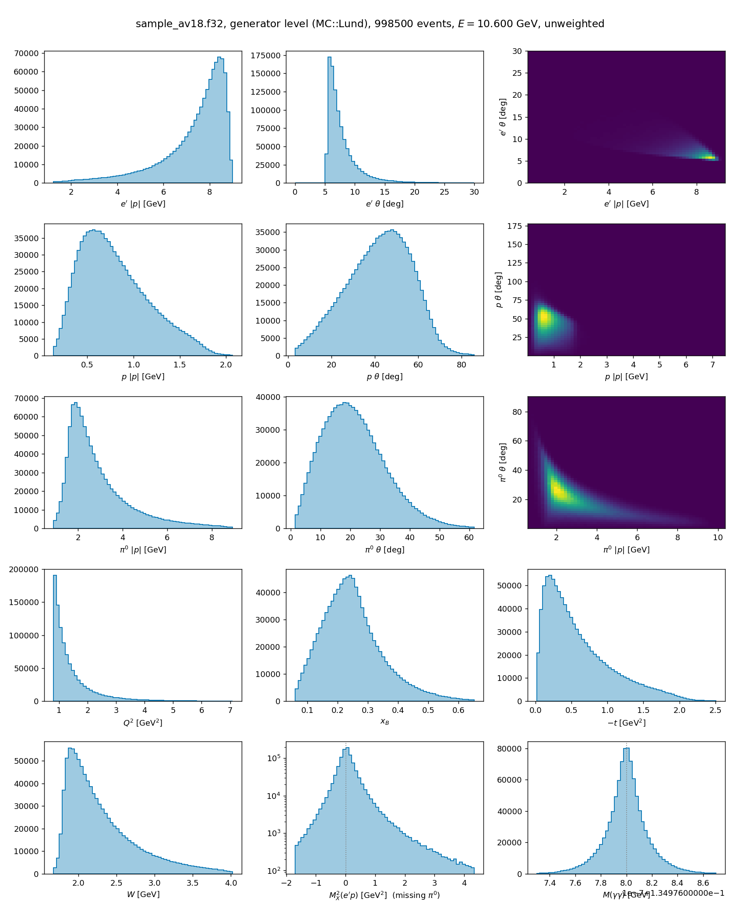
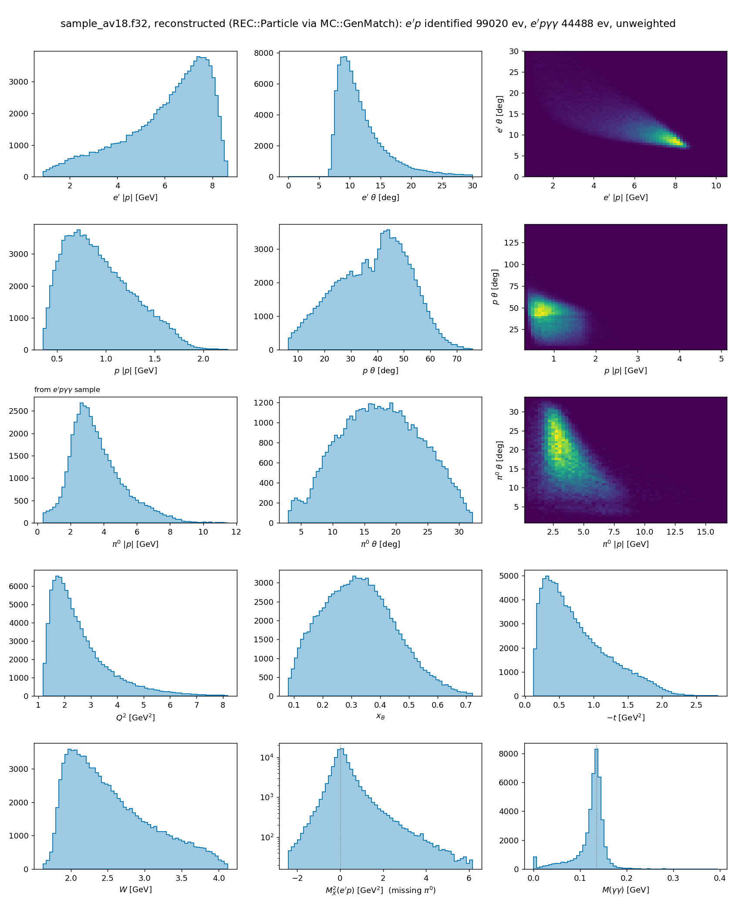
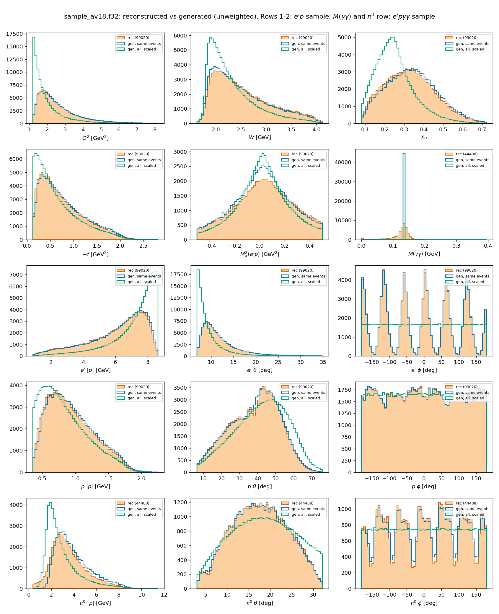
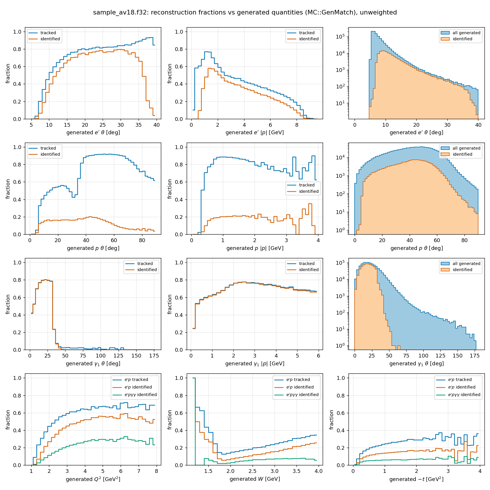

# Production runs — Fermi-motion branch

Every run launched from the `fermi` branch: what it is, what is new in it, where
the output lives, which plots exist. Newest first. **Update this file when a run
is launched, not afterwards** — a run nobody can find is a run nobody made.

Software and configuration are recorded per run because they are not in the
files: a CLAS12 MC hipo carries `RUN::config` (run number, fields) and nothing
about which gemc or coatjava made it.

---

## Index

| id | what | fermi | mode | events | state | results |
|---|---|---|---|---|---|---|
| [`fp_av18`](#fp_av18) | RG-A F18 detector, deuterium generator | **av18** | born | 1 000 000 | **done** | `fermi_prod_av18/` |
| [`fp_none`](#fp_none) | same, free-nucleon control | none | born | 1 000 000 | queued | `fermi_prod_none/` |
| [`fr_av18`](#planned) | radiative twin of `fp_av18` | av18 | rad | 1 000 000 | **not launched** | — |
| [`fr_none`](#planned) | radiative twin of `fp_none` | none | rad | 1 000 000 | **not launched** | — |
| [`rgb_pi0n`](#planned) | RG-B 10.6, pi0 off the NEUTRON | both | rad | 100 000 | cards only | — |

All paths below are on ifarm under `/volatile/clas12/users/vpk/` unless stated.
`fp` is just a label — "fermi production" — with no physics meaning.

---

## What is common to every run here

Unless a run says otherwise:

| | |
|---|---|
| generator | `exclurad_py`, branch `fermi`, at `/volatile/clas12/vpk/exclurad_py_fermi` |
| model | `pi0.amp2609`, `t_nucl = -0.30` |
| beam | 10.6 GeV |
| box | `W2 3.24-16.0`, `Q2 0.80-10.0`, `t -2.00 to -0.001`, `vcut 0` |
| cuts | `y 0-0.90`, `xB 0-1`, `iacc none` |
| vertex | `itarg 1`, `vz -5.5 .. -0.5 cm` (5 cm cell centred at -3 cm) |
| detector | `rga_fall2018.gcard`, **torus -1.00 (inbending)**, solenoid -1.00 |
| software | gemc **5.13** + coatjava **10.0.7** (the pass-2 approved pair for RG-A fa18) |
| per task | 1500 events, ~1.9 h, 4 h wall clock |

**The only thing that differs between the two arms of a comparison is the card's
`fermi` field.** The array scripts differ only in paths and job names; this is
checked with `diff` before launch.

---

## `fp_av18` — deuterium, Born

**Slurm 11877841**, array 1-667. Launched 2026-09-26 03:42, finished 07:43.

**What is new in it:** the first sample ever made with the deuteron target of
this branch. Every event carries a Fermi-smeared struck nucleon and a real
spectator nucleon in the LUND record, and the LUND header says the target is a
deuteron (`1000010020`), not a proton.

    card     /volatile/clas12/vpk/card_av18.txt        (fermi = av18)
    LUND     /volatile/clas12/vpk/fermi_cmp/gen_av18/  1 000 000 events, 401 MB
    chunks   fermi_prod_av18/chunks/                   667 x 1500
    DST      fermi_prod_av18/dst/                      666 files, 24 GB
    ntuple   fermi_prod_av18/out/                      666 files, 167 MB
    merged   fermi_prod_av18/sample_av18.f32           998 500 events
    plots    fermi_prod_av18/plots_av18/               and production/runs/fp_av18_*.png

**Result: 666 COMPLETED, 1 TIMEOUT.** Task 078 hit the wall clock and is being
rerun (slurm 11898075); with it the sample is exactly 1 000 000. Task time
1:56:14 against a 4 h limit.

### Yields

| selection | events | fraction |
|---|---:|---:|
| generated | 998 500 | 1.0000 |
| e' identified | 133 523 | 0.1337 |
| e' and p identified | 99 020 | **0.0992** |
| e' p gamma gamma identified (pi0) | 44 488 | **0.0446** |
| p identified given e' identified | 99 020 | 0.7416 |

For scale, the howto quotes the official RG-A `aao_norad` MC at 10.6 GeV
inbending: 5.6 % for e'p and 0.9 % for e'p gamma gamma. This sample is higher,
but that is the **box**, not Fermi motion: it was chosen from the GEMC
acceptance and keeps 97 % of the accepted phase space against 64 % for the older
cards. **Nothing here can be attributed to Fermi motion until `fp_none` exists.**

---

## `fp_none` — free nucleon, Born (the control)

**Slurm 11898081**, array 1-667. Queued 2026-09-26.

**What is new in it:** nothing, and that is the point. It is `fp_av18` with the
card's `fermi` field set to `none` and everything else byte-identical, so the
difference between the two samples is Fermi motion and nothing else.

    card     /volatile/clas12/vpk/card_none.txt        (fermi = none)
    LUND     /volatile/clas12/vpk/fermi_cmp/gen_none/  1 000 000 events, 244 MB
    chunks   fermi_prod_none/chunks/                   667 x 1500
    output   fermi_prod_none/{dst,out}/                pending

The LUND is 244 MB against 401 MB for the deuteron arm: the difference is one
spectator particle line per event.

---

## Prepared but not launched

### `fr_av18` / `fr_none` — radiative twins, RG-A

Radiative versions of the two runs above, `iborn 0`, everything else identical.
Cards at `/volatile/clas12/vpk/fermi2x2/cards/rad_{none,av18}.txt`.

**Measured before launching: 2.74 s per event** against 6 ms for Born — a factor
450. One million events is ~760 core-hours of generation per arm, plus the same
again for GEMC and reconstruction. Generation therefore has to go to the farm as
its own array (`production/farm/gen_array.sbatch`), not to ifarm, and with 2500
events per task, not the default 5000, which would want 3.8 h against a 4 h wall
clock.

**Open question before launch**, seen on the `fermi = none` timing run, i.e.
*not* a Fermi effect:

    health: stage-2 bound exceeded in 9/954 accepts (max x2.30)
            -- the sample is NOT exactly unweighted; refine table_shape

with the production settings `MAJ_SAFETY=4.0 ETA_PROPOSAL_CAP=5`, `global B =
2.87`. 400 events is thin statistics, but the warning is real and probably also
present in the current `sim_rad` campaign.

### `rgb_pi0n` — RG-B 10.6 GeV, pi0 off the neutron

Cards committed: `cards/rad_pi0n_rgb_none.txt`, `cards/rad_pi0n_rgb_av18.txt`.
100 000 events each, radiative, `pi0n.amp2609` (same vintage as the proton
model, so the two are comparable).

RG-B configuration from `clas12-config prod/setup.json`, `rgb_spring2019`:
torus **-1.00**, solenoid -1.00, beam 10599 MeV, target z -3.0 +- 2.5 cm.
Inbending necessarily means spring 2019 -- `rgb_fall2019` was taken with torus
+1.00 only. Approved pairs: gemc/5.10 + coatjava/10.0.7, gemc/5.11 +
coatjava/11.1.0.

Two things that make this run different from the proton ones, not just a
relabelling:

* **the detected hadron is a NEUTRON**, so the efficiency is a different
  quantity entirely and the yield table cannot be compared with the proton one
  row by row;
* **the spectator is a PROTON**, which is the only configuration where CLAS12
  can see the spectator at all — the CVT tracks protons above ~300 MeV/c, while
  a spectator neutron at 100-300 MeV/c is invisible.

---

## Two things that will bite whoever analyses these samples

**The W box edge is no longer an edge.** Fermi motion smears the *observed* W
(reconstructed with the target at rest) by **131 MeV**, so 4.4 % of the deuteron
sample sits below the box's lower edge and the tail reaches W = 1.71. A card
that must *cover* an observed range has to generate wider than it.

**A hydrogen-tuned missing-mass cut does not transfer.** `v = MX^2(e'p) -
m_pi0^2` has **34 %** of deuteron events above 0.17 against **0 %** for a free
nucleon, because `v ~ -2 p_pi . p_s` — the pion's 3.7 GeV/c momentum is a lever
arm on the 90 MeV/c Fermi momentum. The cut does not merely thin a deuteron
sample by a third, it **biases it in the Fermi momentum**.

---

## How to reproduce or extend

    # generator, born (fast: ~6 ms/event)
    ssh ifarm2402
    cd /volatile/clas12/vpk/exclurad_py_fermi
    python3 -m exclurad_py.run <card> --jobs 20

    # chunk it
    grep -hv '^#' <lund dir>/*_[0-9][0-9].lund > all.lund     # numbered parts only:
                                                             # the unnumbered file is a
                                                             # test sharing part 01's seed
    python3 production/farm/split_lund.py all.lund 1500 chunks/

    # GEMC + reconstruction
    sbatch gemc_array.sbatch          # see fermi_prod_*/gemc_array.sbatch

    # results
    cat out/*.f32 > sample.f32
    python3 production/gemc_check/plot_kinematics.py sample.f32 plots/ --ebeam 10.6

**The one line without which every task dies after its GEMC finishes** (see
`docs/gemc_howto.tex`, troubleshooting):

    export _JAVA_OPTIONS="-Dorg.sqlite.tmpdir=$JT -Djava.io.tmpdir=$JT"   # JT on /volatile
